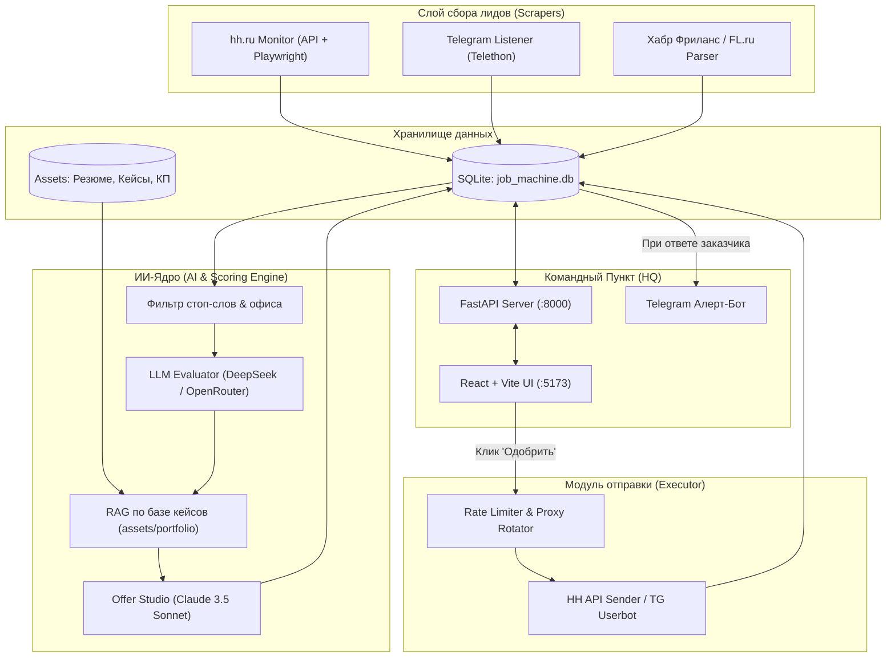

# 🏛 .agent/ARCHITECTURE.md — Системная архитектура JOB-MACHINE

> Этот документ описывает сквозную топологию конвейера, потоки данных, сущности базы данных и конечный автомат статусов лида.  
> 🎯 Полная бизнес-стратегия и разбор всех каналов лидогенерации зафиксированы в [`.agent/LEAD_SOURCES_STRATEGY.md`](file:///f:/JOB-MACHINE/.agent/LEAD_SOURCES_STRATEGY.md).

---

## 1. Сквозная топология системы



---

## 2. Конечный автомат состояний лида (Lead State Machine)

Каждый заказ проходит строгий цикл состояний в базе данных:

```
[new] 
  │  (Парсер нашел вакансию)
  ▼
[ai_scored] 
  │  (AI-скоринг: оценка стека, бюджета, формата удаленки >= 75%)
  ▼
[offer_generated] 
  │  (OpenRouter сгенерировал персонализированный отклик по кейсам)
  ▼
[approved] 
  │  (Пользователь в веб-интерфейсе одобрил текст или авто-апрув)
  ▼
[sent] 
  │  (Отклик отправлен на платформу: hh.ru, TG, биржа)
  ▼
[replied] 🔥
  │  (Заказчик ответил: моментальный алерт в Telegram пользователя)
  ▼
[in_negotiation] 
  │  (Созвон, аудит, обсуждение ТЗ)
  ▼
[closed_won] (Сделка! Retainer 80-90к руб./мес.) ИЛИ [archived]
```

---

## 3. Схема сущностей БД (Schema)

Файл базы: `web-app/backend/job_machine.db` (SQLite).

### Таблица `leads`
- `id`: INTEGER PRIMARY KEY
- `external_id`: VARCHAR (уникальный ID на hh.ru или в TG)
- `title`: VARCHAR (название вакансии/заказа)
- `company`: VARCHAR (компания или имя заказчика)
- `source`: VARCHAR (`hh.ru`, `telegram`, `habr_freelance`, `fl_ru`, `direct`)
- `url`: VARCHAR (прямая ссылка)
- `salary_raw`: VARCHAR (текстовая вилка)
- `salary_min`, `salary_max`: INTEGER
- `contact_info`: VARCHAR (контакт в TG, email, телефон)
- `location`: VARCHAR (удаленка / локация)
- `job_type`: VARCHAR (парт-тайм, проект, подряд)
- `description`: TEXT (исходное описание)
- `tags`: VARCHAR (метки стека)
- `status`: VARCHAR (`new`, `ai_scored`, `offer_generated`, `approved`, `sent`, `replied`, `in_negotiation`, `closed_won`, `archived`)
- `match_score`: INTEGER (0–100)
- `scoring_reason`: TEXT (почему подходит, выделенные боли)
- `generated_offer`: TEXT (текст сопроводительного письма)
- `custom_notes`: TEXT (заметки пользователя)
- `created_at`, `updated_at`, `sent_at`, `replied_at`: DATETIME

### Таблица `knowledge_base`
- `id`: INTEGER PRIMARY KEY
- `title`: VARCHAR
- `category`: VARCHAR (`case_study`, `stack`, `tone_of_voice`, `about_me`)
- `content`: TEXT
- `tags`: VARCHAR
- `is_active`: BOOLEAN

### Таблица `system_settings`
- `id`: INTEGER PRIMARY KEY
- `key`: VARCHAR UNIQUE
- `value`: TEXT
- `description`: VARCHAR
